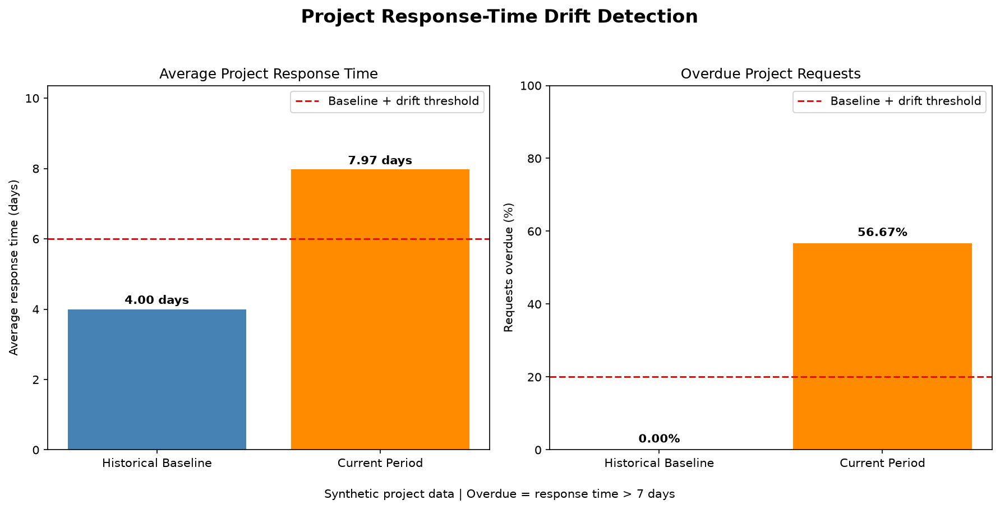

# Detecting Drift in Project Request Response Times

**Brian Cookson | Continuous Intelligence | Project 05 | Custom Application**

## Overview

This project investigates whether recent project request response
times differ meaningfully from historical performance.

Timely responses to project requests help support coordination
and decision-making. Comparing individual requests can identify
isolated delays, but comparing periods can reveal broader changes
in responsiveness.

The objective is to establish a historical baseline, compare it
with recent activity, and determine whether changes in average
response times and overdue request rates exceed defined thresholds.

## Data

The application uses two synthetic datasets containing 30 project
requests each, for a total of 60 observations.

- **Historical reference data:** Represents a period of relatively
  stable project response performance.
- **Current data:** Represents a more recent period with longer
  response times.

Each dataset contains:

- **Request ID:** A unique identifier for each request.
- **Project Phase:** Planning, Design, or Construction.
- **Response Days:** The number of days required to respond.

Both datasets were created specifically for this educational
project and do not contain actual employer or organizational data.

[View Historical Reference Dataset](https://github.com/bcookson85/cintel-05-project-drift/blob/main/data/project_reference_responses.csv)

[View Current Project Dataset](https://github.com/bcookson85/cintel-05-project-drift/blob/main/data/project_current_responses.csv)

## Methods and Tools

The application uses **Python and Polars** to read, validate,
and analyze the project response data.

The analysis follows these steps:

1. Load the historical reference and current project datasets.
2. Validate the required columns and response-time values.
3. Calculate the average response time for each period.
4. Calculate the percentage of requests taking more than seven days.
5. Compare current values against the historical baseline.
6. Calculate the differences between the two periods.
7. Apply defined thresholds to determine whether drift is detected.
8. Export the drift summary to a CSV file.
9. Generate a visualization using Matplotlib.

### Drift Detection Rules

The application uses two illustrative detection thresholds.

**Response-Time Drift:**

Drift is flagged when the absolute difference between current
and historical average response times exceeds **2 days**.

**Overdue-Rate Drift:**

A request is considered overdue when its response time exceeds
**7 days**.

Drift is flagged when the absolute difference between current
and historical overdue percentages exceeds **20 percentage points**.

These thresholds demonstrate the detection technique and are
not established organizational service-level requirements.

## Custom Application

Dr. Case's original project compares historical and current
system metrics, including requests, errors, and latency.

My custom application applies a similar baseline comparison
approach to **project request response-time monitoring**.

The main differences include:

- Two custom datasets containing 60 synthetic project requests.
- Project-specific identifiers and phases.
- Response times measured in days.
- A historical baseline representing normal response performance.
- A seven-day rule for identifying overdue requests.
- Drift detection for both average response times and overdue rates.
- A custom chart showing the differences between observation periods.

This project builds on my earlier work involving project response-time
analysis and rolling monitoring.

[View Custom Drift Detection Application](https://github.com/bcookson85/cintel-05-project-drift/blob/main/src/cintel/project_drift.py)

[View Project Utility Functions](https://github.com/bcookson85/cintel-05-project-drift/blob/main/src/cintel/utils_project.py)

[View Visualization Code](https://github.com/bcookson85/cintel-05-project-drift/blob/main/src/cintel/visualize_project.py)

## Results and Visualization

The custom application successfully processed both datasets
and generated a drift comparison summary.

*Figure 1. Historical and current project response performance,
including average response times, overdue rates, and upper
drift thresholds.*

### Summary of Results

| Metric | Historical Baseline | Current Period | Difference |
|---|---:|---:|---:|
| Project requests | 30 | 30 | 0 |
| Average response time | 4.00 days | 7.97 days | +3.97 days |
| Overdue request rate | 0.00% | 56.67% | +56.67 percentage points |

### Drift Detection Results

| Indicator | Drift Threshold | Drift Detected |
|---|---:|---|
| Average response time | 2 days | Yes |
| Overdue request rate | 20 percentage points | Yes |

The average response time increased from **4.00 days**
during the historical reference period to **7.97 days**
during the current period.

The increase of **3.97 days** exceeded the configured
two-day drift threshold.

The historical dataset had no requests exceeding seven days.
In the current dataset, **56.67%** of requests exceeded seven days.

The increase of **56.67 percentage points** exceeded the
configured 20-percentage-point overdue-rate drift threshold.

Both indicators therefore identified drift.

[View Generated Project Drift Summary](https://github.com/bcookson85/cintel-05-project-drift/blob/main/artifacts/project_drift_summary.csv)

## Interpretation

The most important finding is that comparing current project
response performance with a historical baseline can reveal
changes that may warrant further investigation.

The current period shows nearly double the historical average
response time and a substantial increase in overdue requests.

Both drift indicators exceed their configured thresholds,
providing consistent evidence that the two periods differ.

In a real project environment, these indicators could help
analysts identify potential deterioration in responsiveness
and determine whether further investigation is necessary.

However, the data is synthetic and was deliberately designed
to demonstrate a change in performance.

The results do not establish the cause of the difference
or prove a gradual, sustained change over multiple periods.

## Limitations

This project has several limitations.

First, both datasets are synthetic and contain only
30 observations each. They do not represent real project outcomes.

Second, the drift thresholds are illustrative rather than
based on organizational service-level agreements.

Third, comparing two periods establishes a difference between
their summary statistics but does not independently demonstrate
when or how a change occurred.

Fourth, the analysis combines Planning, Design, and Construction
requests rather than calculating separate drift indicators
for each phase.

Finally, the application uses descriptive comparisons and fixed
thresholds rather than formal statistical significance testing
for the custom response-time data.

## Next Steps

If I continued this project, I would:

- Analyze a larger dataset of appropriately authorized records.
- Compare drift separately across project phases.
- Evaluate whether the detection thresholds match operational needs.
- Apply statistical testing to assess differences between periods.
- Compare several consecutive periods to distinguish sustained
  changes from temporary fluctuations.
- Add automated monitoring alerts and an interactive dashboard.

These improvements could make drift detection more useful
for ongoing project performance monitoring.

## Conclusion

This project demonstrates how drift detection techniques
can be adapted from system monitoring to project request
response-time analysis.

By comparing historical and recent project activity,
the application identified differences in both average
response times and overdue request percentages.

The results illustrate how baseline comparisons and
interpretable thresholds can help analysts recognize
potentially meaningful operational changes.

## Documentation Index

- **Home** - This landing page
- [Project Instructions](project-instructions.md)
- [Glossary](glossary.md)
- [API](api.md)
- [Reactive App](./app/index.html)

## Project Links

- [GitHub Repository](https://github.com/bcookson85/cintel-05-project-drift)
- [Historical Dataset](https://github.com/bcookson85/cintel-05-project-drift/blob/main/data/project_reference_responses.csv)
- [Current Dataset](https://github.com/bcookson85/cintel-05-project-drift/blob/main/data/project_current_responses.csv)
- [Custom Drift Detection Application](https://github.com/bcookson85/cintel-05-project-drift/blob/main/src/cintel/project_drift.py)
- [Generated Results](https://github.com/bcookson85/cintel-05-project-drift/blob/main/artifacts/project_drift_summary.csv)
- [Original Drift Detection Example](https://github.com/bcookson85/cintel-05-project-drift/blob/main/src/cintel/drift_detector.py)

## Project Resources

- [Project Instructions](project-instructions.md)
- [Professional Python Guide](https://denisecase.github.io/pro-analytics-02/)
- [Professional Python Project Explainer](https://pup-pack.github.io/professional-python-project-explainer/)
- [Suggested Datasets](https://denisecase.github.io/pro-analytics-02/reference/datasets/cintel/)
